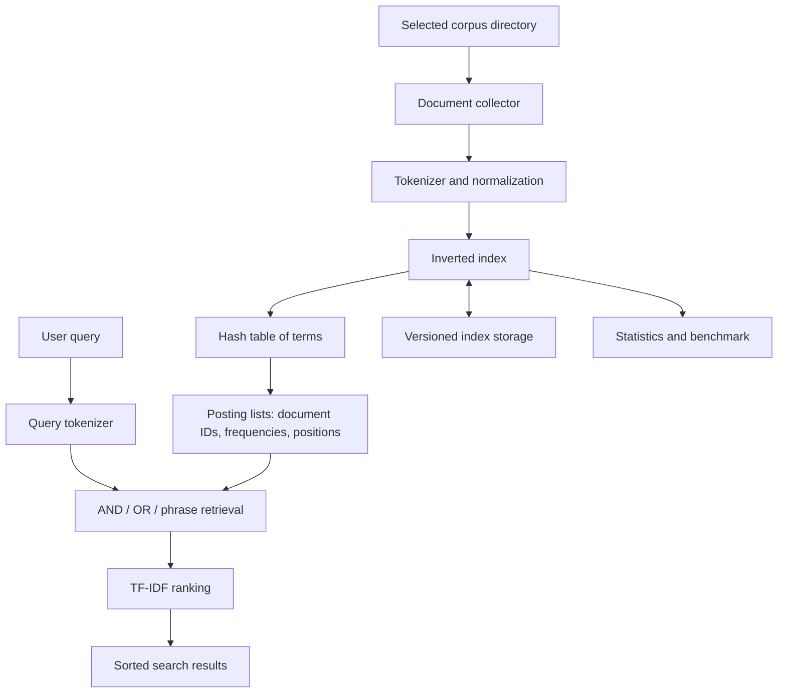

# MiniSearch — A Lightweight Full-Text Search Engine in C

**Tagline:** Search smarter. Understand deeper.  
**Language:** C11  
**Repository:** `MiniSearch-C-Search-Engine`

MiniSearch is a small, educational full-text search engine built from scratch in C. It reads a selected folder of `.txt` documents, tokenizes their contents, builds an inverted index, retrieves matching documents, and ranks results with a transparent TF-IDF formula.

The goal is to make the internal ideas behind a search engine understandable: text processing, hash tables, dynamic arrays, positional postings, information retrieval, file persistence, and careful C memory management.

> MiniSearch is a learning project. Its relevance scores are not intended to match commercial search engines.

## Features

- Index `.txt` documents from one user-selected directory (non-recursive).
- Assign each indexed document an internal numeric ID and retain its name and path.
- Normalize ASCII words to lowercase and split on punctuation and whitespace.
- Handle empty documents, repeated words, and dynamically sized tokens.
- Build an inverted index using a hash table and dynamically growing posting lists.
- Store word positions, enabling exact phrase search.
- Search with single or multiple terms using AND or OR matching.
- Optionally filter a small built-in list of common English stop words.
- Rank results with normalized term frequency and smoothed inverse document frequency.
- List indexed documents, show index statistics, and display frequent terms.
- Save and load a versioned binary index with structural validation.
- Benchmark indexing and query execution with a monotonic timer where available.
- Run five automated test programs with `make test`.

## Example terminal session

Build the program:

```sh
make
```

Index the included sample corpus and open the menu:

```sh
./build/minisearch data/sample_documents
```

Choose **2** to search, enter `data structures`, and choose **1** for AND search. One observed run produced this result (execution time is machine-dependent):

```text
Indexed 5 document(s), 106 unique terms and 156 tokens.

Search results (1 matching document):

1. 01_data_structures.txt
   Matched terms: data, structures
   Relevance score: 0.090280

Search time: 0.000007 seconds
```

You can also start with an empty index and use menu option **1**:

```sh
./build/minisearch
```

## Requirements

- A C11 compiler: GCC or Clang.
- GNU Make or a compatible `make` implementation.
- The standard C library and the math library (`-lm` on the tested GCC/Clang toolchains).
- On Windows, a POSIX-like build environment such as MSYS2/MinGW is expected; the directory scanner uses the Windows file enumeration API in that build.

No external search service, database, or third-party C library is used.

## Build and run

```sh
# Build the application
make

# Run the interactive application
./build/minisearch

# Index a corpus immediately, then open the interactive menu
./build/minisearch data/sample_documents

# Show command-line usage
./build/minisearch --help
```

To select Clang explicitly:

```sh
make clean
make CC=clang
```

The build uses strict warnings by default:

```text
-std=c11 -Wall -Wextra -Wpedantic -Wshadow -Wconversion -O2
```

## Menu reference

| Option | Action |
|---|---|
| 1 | Index `.txt` files from a directory; choose whether to remove stop words |
| 2 | Search using AND, OR, or exact phrase mode |
| 3 | List document IDs, names, paths, and indexed token counts |
| 4 | Show document, term, token, average-length, and estimated-memory statistics |
| 5 | Show the ten most frequent indexed terms |
| 6 | Save the current index (default: `minisearch.idx`) |
| 7 | Load and validate an index file (default: `minisearch.idx`) |
| 8 | Rebuild the index from a selected directory |
| 9 | Show project information and tokenizer scope |
| 10 | Benchmark indexing and a query on a selected corpus |
| 0 | Exit |

### Search modes

- **AND:** a document must contain every distinct query term.
- **OR:** a document must contain at least one distinct query term.
- **Exact phrase:** all query tokens must occur in the same order at consecutive indexed positions.

Queries are case-insensitive. Query punctuation acts as a separator, just as it does in documents.

## Sample corpus and queries

Five example documents are provided in `data/sample_documents/`. Suggested searches are in `examples/sample_queries.txt`.

Try:

```text
data structures
binary search
C programming
search engine
malloc pointers
```

## Architecture



The implementation is split across `document`, `tokenizer`, `index`, `search`, `ranking`, `storage`, `timer`, and `cli` modules. More detail is in [`docs/ARCHITECTURE.md`](docs/ARCHITECTURE.md).

## Data structures

| Structure | Purpose | Reason |
|---|---|---|
| Dynamic document array | Maps internal IDs to document metadata | Fast lookup by document ID and simple ownership |
| Hash table with separate chaining | Maps a term to its `TermEntry` | Average-case constant-time term lookup when hashes are well distributed |
| Dynamic posting array | Stores each term's matching documents | Compact sequential storage and binary search by document ID |
| Position array per posting | Stores each occurrence's token position | Enables exact phrase matching |
| Dynamic result array | Stores matching documents and scores | Can be sorted with `qsort` |

## Ranking formula

For a term `t` in a document `d`:

```text
TF(t, d)  = frequency(t, d) / indexed_token_count(d)
IDF(t)    = ln((N + 1) / (df(t) + 1)) + 1
score(d)  = sum over distinct query terms [TF(t, d) * IDF(t)]
```

Where:

- `N` is the number of indexed documents.
- `df(t)` is the number of documents containing term `t`.
- `frequency(t, d)` is the number of occurrences of `t` in `d`.
- `indexed_token_count(d)` is the document length after any configured stop-word filtering.

The `+1` smoothing avoids zero IDF values and avoids division by zero in the ratio. Documents with higher scores are shown first. Ties are ordered by document ID. This is a simple, explainable TF-IDF variant, not a production ranking model.

## Persistence format

`storage.c` writes a portable little-endian binary format. The file contains an eight-byte magic signature, a format version, flags, document/term/token counts, document metadata, terms, postings, frequencies, and token positions. It never serializes pointer values.

The loader checks the version, length bounds, document IDs, term characters, posting order, position bounds, token totals, and per-document posting totals. It loads into a temporary index and only replaces the current index after full validation. The current format version is `1`.

## Testing

Run all automated tests:

```sh
make test
```

Test suites:

- `test_tokenizer`: lowercase normalization, punctuation, digits, and stop-word filtering.
- `test_index`: multiple files, repeated words, empty files, and term frequencies.
- `test_search`: AND, OR, phrase, case-insensitive queries, no results, and empty queries.
- `test_ranking`: manual calculations for the smoothed IDF and TF-IDF score.
- `test_storage`: save/load, phrase search after loading, and truncated-file rejection without destroying the current index.

The project was built and tested in the available environment with Clang 17 using the strict warning flags above. All five test suites passed. The same five suites also passed with AddressSanitizer and UndefinedBehaviorSanitizer enabled. These are environment-specific validation results, not a claim that every operating system/compiler combination has been tested.

## Benchmarking

Choose menu option **10**, enter a corpus directory, and enter a search query. The benchmark reports the timer backend, document and token counts, indexing time, search time, matching document count, and estimated index memory.

For a meaningful published benchmark, record:

- CPU and memory configuration.
- Operating system and version.
- Compiler name/version and exact flags.
- Corpus source, corpus size, and document count.
- Whether stop-word filtering was enabled.
- Repeated measurements and the method used to summarize them.

No benchmark numbers are included in this repository because no reproducible external benchmark dataset/hardware study has been conducted. The memory number is an estimate of allocated data structures and does not include every allocator/runtime overhead.

## Complexity overview

Let `T` be the number of input characters, `W` the number of indexed tokens, `U` the number of unique terms, `N` the number of indexed documents, and `Q` the number of distinct query terms.

- Tokenization: `O(T)` time for a file; token memory grows with the longest token.
- Index construction: expected `O(W)` term lookups/inserts with a well-distributed hash table, plus dynamic-array growth.
- Hash lookup: expected `O(1)`; worst case `O(U)` in a heavily collided bucket.
- Posting lookup: `O(log P)` by binary search, where `P` is the posting count for a term.
- Current query evaluation: `O(N × Q × log P)` as it examines each indexed document and checks each query term; exact phrase checks also examine candidate positions.
- Result ordering: `O(R log R)` for `R` matching documents.

## Known limitations

1. Tokenization is ASCII alphanumeric only. Unicode words and language-specific normalization are not implemented.
2. Corpus scanning is non-recursive and indexes `.txt` files directly inside the selected directory.
3. Stop words are a short built-in English list, not a configurable language model.
4. Search supports AND, OR, and exact phrase modes, not a full query language with parentheses or arbitrary Boolean expressions.
5. The application is single-threaded and intended for learning-scale local corpora.
6. Search scores are a simple TF-IDF variant; they are not calibrated to commercial search engines.
7. The binary index format is versioned but currently supports only version 1.
8. Windows path handling uses the ANSI Win32 file enumeration API; broad Unicode-path support has not been added.
9. Allocation-failure injection and large-scale external corpus benchmarking are not included in the automated tests.

## Learning outcomes

By reading and extending MiniSearch, a student can practise:

- C structs, pointers, header files, and modular compilation.
- `malloc`, `calloc`, `realloc`, and `free` with explicit ownership.
- File streams and error checking.
- Dynamic arrays, hash tables, linked bucket chains, and binary search.
- Tokenization, inverted indexes, positional retrieval, and TF-IDF.
- Portable serialization and defensive validation.
- Unit tests, compiler warnings, sanitizers, Makefiles, and Git workflows.

A guided module-by-module walkthrough is in [`docs/LEARNING_GUIDE.md`](docs/LEARNING_GUIDE.md). Project review questions are in [`docs/PROJECT_REVIEW_QA.md`](docs/PROJECT_REVIEW_QA.md).

## GitHub publication

Create a public repository named `MiniSearch-C-Search-Engine` on GitHub. Because this project already contains a local README, leave GitHub's **Add a README** option unchecked. Then run these commands from this project's root directory, replacing `<YOUR_GITHUB_USERNAME>` with your GitHub username:

```sh
git init
git add .
git commit -m "Initial MiniSearch C11 search engine"
git branch -M main
git remote add origin https://github.com/<YOUR_GITHUB_USERNAME>/MiniSearch-C-Search-Engine.git
git push -u origin main
```

Verify that the public repository shows `README.md`, `src/`, `include/`, `tests/`, `docs/`, `data/`, `examples/`, `Makefile`, `LICENSE`, and `.gitignore`. Review the staged files before committing. Do not commit compiled binaries, generated index files, personal information, or credentials.

## License

This project is released under the MIT License. See [`LICENSE`](LICENSE).
